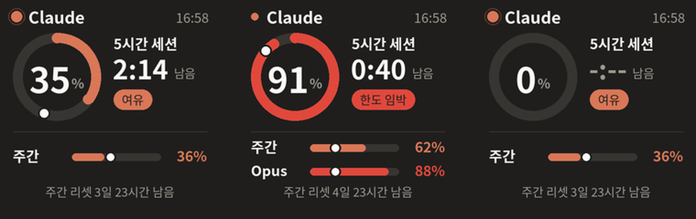

# smalltv-claude-meter

**GeekMagic SmallTV Ultra**(240×240 소형 디스플레이)를 책상 위 **Claude 사용량 모니터**로 쓰는 프로그램입니다.
5시간 세션 사용률과 남은 시간, 주간 사용률을 한눈에 보여줍니다.

> ⚠️ **비공식 프로젝트입니다.** Anthropic과 무관합니다. 사용량을 읽는 경로는 공개 API가 아니어서 예고 없이 바뀌거나 막힐 수 있습니다.

왼쪽부터: 평소 · 한도 임박(85% 이상) · 세션 없음

## 화면 읽는 법

| 요소 | 의미 |
|---|---|
| 큰 원 | 5시간 세션 사용률. 85% 이상이면 빨간색 |
| `2:14 남음` | 5시간 세션이 리셋될 때까지 남은 시간 |
| 원·막대 위 **흰 점** | 그 기간 중 **지나간 시간의 위치**. 색 막대가 흰 점을 앞지르면 시간보다 빨리 쓰고 있다는 뜻 |
| 주간 / Opus 막대 | 7일 한도 사용률 (모델별 한도가 있으면 함께 표시) |
| 왼쪽 위 주황 점 | 갱신될 때마다 크기가 바뀜. 멈춰 있으면 갱신이 끊긴 것 |

## 동작 방식

- 장비 **펌웨어는 건드리지 않습니다.** 순정 펌웨어의 사진 앨범 기능에 PC가 그린 이미지를 1분마다 올립니다.
- 이미지 두 장(A/B)을 번갈아 써서 교체 중에 빈 화면(No image)이 뜨지 않습니다.
- 장비가 바쁘거나 잠시 끊겨도 프로그램이 꺼지지 않고 다시 연결을 시도합니다.
- `claude_meter.py` 파일이 바뀌면 실행 중인 모니터가 스스로 새 버전으로 다시 시작합니다.

### 사용량 데이터 출처 (자동 선택)

1. **Claude Code 상태표시줄** — Claude Code가 응답할 때마다 넘겨주는 사용량을 받습니다. 네트워크 호출이 없어 가장 안정적입니다. 설치할 때 자동으로 연결되며, 기존 상태표시줄이 있으면 지우지 않고 함께 실행되도록 이어 붙입니다.
2. **Claude Code 로그인 정보로 사용량 조회** — 15분 간격. 자주 부르면 일시 차단(429)되므로 간격을 넓게 두고, 실패하면 10→60분까지 쉬었다 다시 시도합니다.
3. **claude.ai 세션키**(선택) — `set_session.bat`으로 직접 넣으면 5분 간격으로 조회합니다. 세션키는 이 PC의 `config.json`에만 저장됩니다.

## 준비물

- GeekMagic **SmallTV Ultra** (순정 펌웨어, PC와 같은 2.4GHz Wi-Fi에 연결)
- **Windows PC** + [Python 3.9 이상](https://www.python.org/downloads/) (설치할 때 "Add python.exe to PATH" 체크)
- Claude Pro / Max 등 사용량 한도가 있는 플랜, 그리고 Claude Code 로그인 또는 claude.ai 세션키

## 설치

1. 이 저장소를 내려받아 압축을 풉니다. (`Code` → `Download ZIP`)
2. **`install.bat` 더블클릭**
3. 처음 한 번 장비 IP를 묻습니다. 장비를 켤 때 화면에 표시되는 IP를 입력하세요.

설치하면 PC를 켤 때마다 창 없이 자동 실행됩니다.

| 파일 | 용도 |
|---|---|
| `install.bat` | 설치·업데이트 (기존 실행분은 자동 교체) |
| `uninstall.bat` | 끄기 + 자동 시작 해제 + 장비를 원래 시계 화면으로 |
| `check.bat` | 진단 — 장비 연결, 데이터 출처, 차단 대기 시간, 최근 기록 |
| `set_session.bat` | (선택) claude.ai 세션키 입력 |

## 설정 (`config.json`)

처음 실행할 때 만들어지며, 바꾸면 1분 안에 반영됩니다. 항목은 `config.example.json` 참고.

| 항목 | 기본값 | 설명 |
|---|---|---|
| `device_ip` | — | 장비 IP |
| `interval_seconds` | `60` | 화면 갱신 간격(초) |
| `layout` | `ring` | `ring`: 원형 게이지 / `countdown`: 남은 시간을 크게 |
| `rotate` | `false` | `true`면 순정 시계·날씨 화면과 번갈아 표시 |
| `rotate_themes` | `[1, 3]` | 번갈아 보일 테마 (1 시계·날씨, 2 예보, 3 이 화면, 4~7 시계 스타일) |
| `rotate_seconds` | `15` | 화면당 표시 시간(초) |
| `brightness` | `null` | 0~100, `null`이면 건드리지 않음 |

## 문제 해결

- **"대기 중 / 최근 5시간 사용 없음"** — 실제로 진행 중인 세션이 없는 상태입니다. Claude를 쓰면 다음 조회 때 바뀝니다.
- **"조회 대기 중 · 429"** — 사용량 조회가 잠시 막힌 상태입니다. 그대로 두면 자동으로 풀립니다. Claude Code로 대화 한 번 하면 바로 갱신됩니다.
- **장비 시계가 멈춤 / 응답 없음** — 장비 USB를 뽑았다 다시 꽂으세요. 모니터는 자동으로 다시 연결합니다.
- 그 밖에는 `check.bat` 결과와 폴더의 `meter.log`를 확인하세요.

## 알려진 제한

- 남은 시간은 **분 단위**입니다. 초 단위 GIF 애니메이션은 장비(ESP8266)가 재생 중 다른 요청을 처리하지 못해 멈추는 문제가 있어 넣지 않았습니다.
- 순정 펌웨어의 테마 자동 전환은 제조사 표기상 실험 기능입니다.
- 현재 Windows 기준으로 만들어졌습니다. 화면 생성·전송 부분은 macOS/Linux에서도 동작하지만 자동 시작 등록은 Windows 전용입니다.

## 참고

- 장비 HTTP 프로토콜: [geekmagic-stats device-protocol.md](https://docs.rs/crate/geekmagic-stats/latest/source/device-protocol.md)
- Claude Code 상태표시줄: [공식 문서](https://code.claude.com/docs/en/statusline)

---

## English summary

Turns a **GeekMagic SmallTV Ultra** (240×240, stock firmware) into a desk monitor for your **Claude plan usage** — 5-hour session %, time until reset, and weekly limits. A Windows PC renders a 240×240 JPEG every minute and uploads it to the device's photo-album over the LAN (A/B swap, so no "No image" flicker). White dots on the ring and bars show how much of the window has elapsed: if the colored bar is ahead of the dot, you're burning faster than time.

Usage source, in order: Claude Code statusline hook (no network call; chains any existing statusline) → Claude Code OAuth usage endpoint (15-min interval with 429 backoff) → optional claude.ai `sessionKey`.

**Install:** install Python 3.9+ (add to PATH), download this repo, double-click `install.bat`, enter the device IP. `uninstall.bat` restores the stock clock.

**Unofficial — not affiliated with Anthropic.** The usage endpoints are undocumented and may change or be rate-limited at any time. UI text is Korean.

License: MIT
